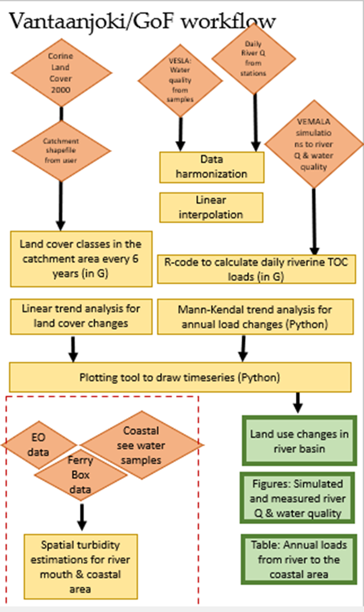
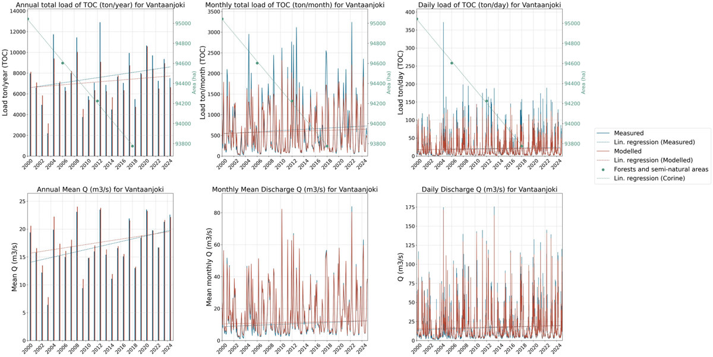

# From catchment to river loads

Chapter 2 of 4

    
Anna-Kaisa Ronkanen (Syke) presents the connected source-to-sea analysis: two linked workflows, one for the catchment and river, and one that follows the river into the coastal sea. The chapter then walks through the first workflow, which combines harmonised <a href="../../reference/glossary#corine-land-cover">CORINE Land Cover</a> data from 2000 to 2018 with river measurements to calculate <a href="../../reference/glossary#total-organic-carbon">total organic carbon</a> (TOC) loads.

    <iframe src="https://www.youtube.com/embed/KnRRrDn_-PQ" title="From catchment to river loads: workflow and land use" frameborder="0" allow="accelerometer; autoplay; clipboard-write; encrypted-media; gyroscope; picture-in-picture; web-share" referrerpolicy="strict-origin-when-cross-origin" allowfullscreen></iframe>

## Workflow structure

<figure class="diagram diagram--svg">

<svg viewBox="0 0 800 340" role="img" aria-labelledby="gof-title gof-desc">
  <title id="gof-title">Source-to-sea observation chain, Vantaanjoki to the Gulf of Finland</title>
  <desc id="gof-desc">Three observation layers along one continuum: CORINE land-use data over the catchment, in-river sensors measuring discharge and water quality, and FerryBox transects sampling coastal gradients in the Gulf, with Earth observation covering the whole chain from above.</desc>

  <defs>
    <linearGradient id="gofRiver" x1="0" y1="0" x2="1" y2="0">
      <stop offset="0%" stop-color="#34d399"/>
      <stop offset="100%" stop-color="#0ea5e9"/>
    </linearGradient>
    <linearGradient id="gofSea" x1="0" y1="0" x2="0" y2="1">
      <stop offset="0%" stop-color="#0284c7"/>
      <stop offset="100%" stop-color="#075985"/>
    </linearGradient>
  </defs>

  <text x="400" y="36" class="fig-title" text-anchor="middle">From catchment to coastal sea</text>

  <!-- Catchment relief -->
  <path d="M0 196 Q 140 164 300 214 T 520 240 L 520 340 L 0 340 Z" fill="#334155"/>
  <path d="M0 220 Q 150 196 300 236 T 520 262 L 520 340 L 0 340 Z" fill="#1e293b"/>

  <!-- River corridor -->
  <path d="M 0 236 Q 150 220 280 250 T 520 278 L 520 296 Q 300 268 150 244 T 0 254 Z" fill="url(#gofRiver)"/>

  <!-- Coastal sea -->
  <path d="M 500 246 C 600 240 700 224 800 224 L 800 340 L 500 340 Z" fill="url(#gofSea)"/>

  <!-- Earth observation -->
  <g transform="translate(560, 92)">
    <rect x="-24" y="-12" width="48" height="24" rx="4" fill="#e2e8f0"/>
    <rect x="-64" y="-4" width="38" height="8" fill="#3b82f6"/>
    <rect x="26" y="-4" width="38" height="8" fill="#3b82f6"/>
    <circle cx="0" cy="0" r="5" fill="#f87171"/>
    <text x="0" y="-26" class="fig-label" text-anchor="middle">Earth observation</text>
    <path d="M -10 14 L -230 108" stroke="#f87171" stroke-width="2" stroke-dasharray="6 5" opacity="0.55"/>
    <path d="M 6 14 L 92 122" stroke="#f87171" stroke-width="2" stroke-dasharray="6 5" opacity="0.55"/>
  </g>

  <!-- Observation nodes -->
  <g transform="translate(120, 190)">
    <circle cx="0" cy="0" r="13" fill="#f59e0b" stroke="#0f172a" stroke-width="3"/>
    <text x="0" y="-26" class="fig-label" text-anchor="middle">Catchment</text>
    <text x="0" y="34" class="fig-sub" text-anchor="middle">CORINE land use</text>
  </g>

  <g transform="translate(330, 250)">
    <circle cx="0" cy="0" r="13" fill="#10b981" stroke="#0f172a" stroke-width="3"/>
    <text x="0" y="-26" class="fig-label" text-anchor="middle">River sensors</text>
    <text x="0" y="34" class="fig-sub" text-anchor="middle">Discharge &amp; quality</text>
  </g>

  <g transform="translate(662, 268)">
    <circle cx="0" cy="0" r="13" fill="#818cf8" stroke="#0f172a" stroke-width="3"/>
    <text x="0" y="-26" class="fig-label" text-anchor="middle">FerryBox</text>
    <text x="0" y="34" class="fig-sub" text-anchor="middle">Coastal gradients</text>
  </g>

  <!-- Transport direction -->
  <path d="M 150 316 L 690 316" stroke="#475569" stroke-width="2" stroke-dasharray="7 5"/>
  <polygon points="690,311 702,316 690,321" fill="#475569"/>
  <text x="150" y="306" class="fig-note">Material transport, land to sea</text>
</svg>

<figcaption>Figure 1: The source-to-sea continuum connecting land use, riverine transport, and coastal observation.</figcaption>
</figure>

<figure class="diagram">
    
    <figcaption>Figure 2: The full Vantaanjoki and Gulf of Finland workflow. The catchment and river branch feeds the load and trend outputs; the dashed box marks the coastal branch covered in Chapter 3.</figcaption>
</figure>

## Result

<figure class="diagram">
    
    <figcaption>Figure 3: Measured and modelled TOC loads (top) and river discharge (bottom) at annual, monthly and daily resolution, with the decline in forest and semi-natural area from CORINE overlaid in green.</figcaption>
</figure>

    <strong>RESULT</strong>
    
Between 2000 and 2018, artificial surfaces in the catchment grew by nearly 10% while forest and semi-natural areas shrank. Over the same period TOC loads show an increasing trend, but river discharge rose too. Trends that happen at the same time do not prove cause and effect, so reading the TOC signal needs both land cover change and hydrology on one timeline.

---
