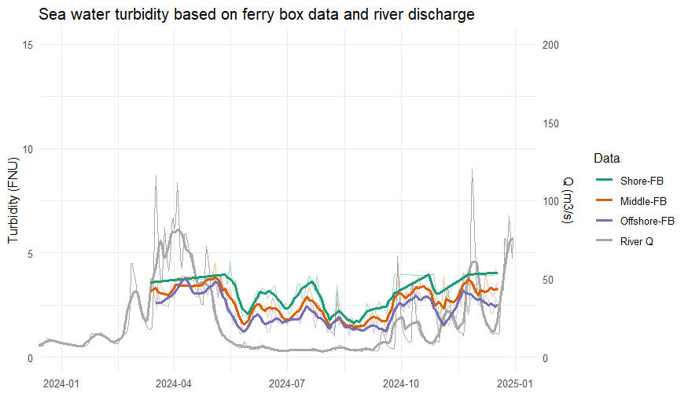
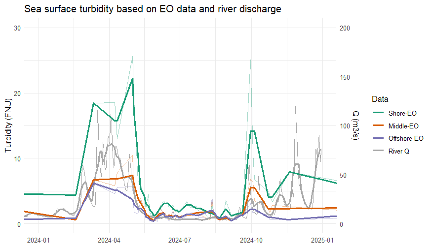

# FerryBox and turbidity in the coastal sea

Chapter 3 of 4

    
Maria Kämäri (Syke) follows the story from the river into the sea. <a href="../../reference/glossary#ferrybox">FerryBox</a> systems on commercial ships measure the sea along the same route between Helsinki and Stockholm, again and again. Combined with river discharge and <a href="../../reference/glossary#sentinel-2">Sentinel-2</a> satellite observations, they show how the Vantaanjoki <a href="../../reference/glossary#turbidity">turbidity</a> plume changes from the coast to open water and through the seasons.

    <iframe src="https://www.youtube.com/embed/2cbknelTBFg" title="FerryBox and turbidity in the Gulf of Finland" frameborder="0" allow="accelerometer; autoplay; clipboard-write; encrypted-media; gyroscope; picture-in-picture; web-share" referrerpolicy="strict-origin-when-cross-origin" allowfullscreen></iframe>

## Result

<figure class="diagram">
    
    <figcaption>Figure 1: The three FerryBox aggregation areas along the ship route, from the coast to offshore, and the automated river stations.</figcaption>
</figure>

<figure class="diagram">
    
    <figcaption>Figure 2: Satellite turbidity at the shore, middle and offshore sites against river discharge. Peaks follow spring snowmelt and autumn high flow, strongest near the coast.</figcaption>
</figure>

    <strong>RESULT</strong>
    
The river signal is clearly visible at sea: turbidity is highest close to the coast and drops offshore, rising with spring snowmelt and autumn rain. In summer, phytoplankton rather than river input drives the satellite signal. Satellite and FerryBox values do not always agree, because satellites see the surface layer, where light fresh river water floats, while the FerryBox takes in water at about 5 m depth. No single dataset gives the full picture; together they trace the catchment signal into the sea.

---
